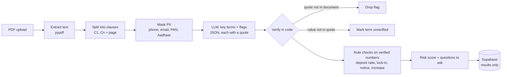

# Rental Agreement Red-Flag Checker

Upload a rental agreement PDF and see, in plain English, which clauses work against you: each one with the
exact line it comes from and what to ask your landlord to change.

**Live demo:** https://YOUR-APP.vercel.app · Try the built-in sample agreements (fictional).

> **Problem:** tenants sign 11-month agreements without reading them, then lose deposit money to clauses they
> missed: a 10-month deposit, an 11-month lock-in that forfeits the deposit, "painting charges", one-sided notice.

## How it works



1. **Clauses, not one big blob.** The PDF is split into numbered clauses with page numbers, so every finding can
   point to *Clause 6 · page 1*.
2. **Privacy first.** Phone numbers, emails, PAN and Aadhaar numbers are masked before anything goes to the LLM.
   The PDF is processed in memory and never stored; only the results are saved (30 days) for the share link.
3. **The AI proposes, code verifies.** The model must return a verbatim quote for each flag. The backend checks
   that the quote really exists in that agreement (exact match after normalising, else fuzzy match ≥ 88%).
   Anything it can't find is dropped and counted, so made-up clauses never reach the user.
4. **Numbers are checked, then rules run in code.** A term like "deposit ₹4,00,000" is only trusted if that number
   appears in its quote (handles `4,00,000`, `4 lakh`, `three (3) months`, `15 days`). Deposit-to-rent ratio,
   lock-in length, notice periods (including landlord vs tenant asymmetry) and rent increases are then
   checked by fixed rules, not judged by the LLM.
5. **Robust to messy model output.** Each flag is validated on its own (a bad item is dropped, not fatal); a broken
   response gets one repair attempt; provider errors are surfaced, not retried blindly.

## Tech

| Layer | Stack |
|---|---|
| Frontend | React 19 + Vite, plain CSS, deployed on **Vercel** |
| Backend | Python, FastAPI, pypdf, pydantic, deployed on **Render** |
| Database | **Supabase** Postgres via its REST API (row-level security on, server-only key) |
| AI | Any OpenAI-compatible chat API (JSON mode) |

## Run locally

```bash
# backend
cd backend
python -m venv .venv && source .venv/bin/activate
pip install -r requirements-dev.txt
cp .env.example .env    # add LLM_* values; Supabase is optional locally (falls back to memory)
set -a && source .env && set +a
uvicorn app.main:app --reload --port 8000
pytest -q               # 18 tests, scripted LLM, no API key needed

# frontend (new terminal)
cd frontend
npm install
echo "VITE_API_URL=http://localhost:8000" > .env.local
npm run dev
```

Evaluate on the labelled sample agreements with a real model: `python evals/run_eval.py`. This reports
category recall, false alarms, risk-level accuracy and the share of AI flags whose quotes were grounded.

## Deploy

1. **Supabase:** create a project → SQL Editor → run `supabase/schema.sql`. Copy the Project URL and the
   secret (service_role) key from Project Settings → API.
2. **Render:** New → Blueprint → pick this repo (reads `render.yaml`). Fill in `LLM_API_KEY`, `LLM_BASE_URL`,
   `LLM_MODEL`, `SUPABASE_URL`, `SUPABASE_SERVICE_KEY`, and `ALLOWED_ORIGINS` (your Vercel URL). Check
   `https://<service>.onrender.com/api/health` shows `"llm_configured": true, "store": "supabase"`.
3. **Vercel:** Add New → Project → this repo, **Root Directory `frontend`**, framework Vite. Add env var
   `VITE_API_URL=https://<service>.onrender.com` and deploy.
4. Put the final Vercel URL into Render's `ALLOWED_ORIGINS` (comma-separate if you have several).

Render's free tier sleeps after ~15 minutes idle. The frontend pings `/api/health` on load and tells the user if
the first request is slow.

## API

| Method | Path | |
|---|---|---|
| `POST` | `/api/analyze` | multipart `file` (PDF ≤ 5 MB, ≤ 25 pages) → analysis with `id` |
| `GET` | `/api/analyses/{id}` | a saved analysis (for share links) |
| `GET` | `/api/health` | status |

## Explaining it in an interview

- **One line:** "It reads a rental agreement and shows the risky clauses with the exact quote and page, so a
  tenant knows what to negotiate before signing."
- **The interesting part:** LLMs make things up, so nothing the model says is shown unless the backend can find
  its quote in the document. Numbers are verified against the quote, and the money rules are plain code.
- **Trade-offs:** text PDFs only (scans would need OCR or a vision model); fuzzy matching tolerates small OCR-style
  differences but rejects paraphrases; results are stored, documents are not.
- **Next steps:** OCR for scanned agreements, highlight clauses on a PDF preview, Hindi/Kannada explanations.

_Not legal advice. All sample names and documents are fictional._
